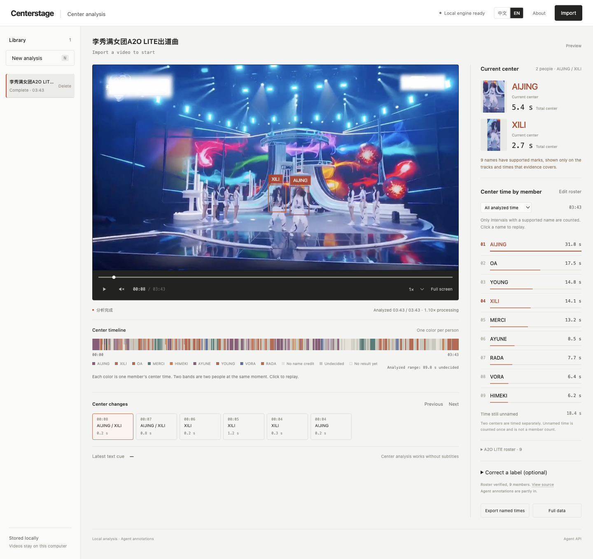

# CenterStage

[中文](README.md)

Local stage-center analysis. Import a performance video and review center boxes, a member-colored timeline, and cumulative center time in a browser on this computer.



This is the English interface for the A2O LITE debut stage, NEON, at **0:08**. The two centers are **XILI** and **AIJING**. Timeline colors follow members who already have an explicit annotation on this job, and the ranking is that job’s cumulative center time.

The case video is the 1280×720, 3-minute-44-second file [a2o-lite-neon.mp4](https://github.com/streetlightstartupnotes/centerstage/releases/download/v0.2.0/a2o-lite-neon.mp4) (126 MB). It is larger than Git’s per-file limit, so it is attached to the [v0.2.0 release](https://github.com/streetlightstartupnotes/centerstage/releases/tag/v0.2.0). Model weights and other local jobs stay out of the repository. Importing this file again does not automatically restore the names in the screenshot.

Give this repository to an existing agent. Setup, startup, source research, and evidence-backed annotation are documented in [AGENTS.md](AGENTS.md) and [AGENT_GUIDE.md](AGENT_GUIDE.md).

```sh
uv sync --frozen
uv run centerstage serve --port 8640
```

Open <http://127.0.0.1:8640>. Requires Python 3.12 or 3.13 and uv. Dependency versions are locked in `uv.lock`. The first launch prepares the local model; that time is separate from the first playable segment. Run one server process per data directory.

An agent can also import from the command line:

```sh
uv run centerstage analyze /absolute/path/performance.mp4 --wait
uv run centerstage requests
uv run centerstage agent-context JOB_ID
```

Analysis runs locally after the model is prepared. Source lookup is done by the agent that receives the repository. Uploading a video does not by itself wake an arbitrary agent.

## What works now

- Import MP4, MOV, M4V, MKV, and WebM, up to 2 GB, 30 minutes, and 4K.
- Local RTMO-s detection, OC-SORT / ByteTrack / CBIoU tracking, shot changes, and an experimental visual center score.
- Playback can start while analysis continues. Boxes, the timeline, and totals use media time.
- The interface switches between Chinese and English. Play, pause, and sound are icons. A library row can be deleted.
- A name with an explicit source and a time range appears on the current center, the colored timeline, and the member ranking.
- CSV exports named durations. JSON keeps the full analysis and diagnostic data.
- Light workbench: library on the left, player and timeline in the center, current center and ranking on the right.

A track count is not a member count. A roster, a sung-credit caption, or similar clothing does not by itself identify the person in frame. Garment links may combine anonymous time. They do not copy names.

Named totals follow video time. Pause, rewind, and replay do not add the same moment twice. Two centers at one moment are counted separately when each has a supported name. Unnamed center intervals are unioned, so two anonymous boxes do not become twice the duration.

## Not finished

- Automatic names for an arbitrary new video.
- Remembering the same person across shots.
- A name on every center box. This case still has unnamed time in group formations, two-name credits, and frames that cannot be told apart.
- An independent accuracy check of the center decision.

The center rule uses geometric position and the count of visible faces. It is an experimental visual baseline, not an official formation chart and not a singer identifier. Speed depends on the machine, resolution, sample rate, and scene. Playback waits when analysis falls behind, or the whole video can be analyzed before watching.

See [docs/NAME_STATUS.md](docs/NAME_STATUS.md) and [docs/VALIDATION.md](docs/VALIDATION.md).

## Agent API

| Endpoint | Purpose |
| --- | --- |
| `GET /api/health` | Local engine and optional OCR status |
| `POST /api/jobs` | Upload; multipart field `file` |
| `GET /api/jobs` | Video library |
| `DELETE /api/jobs/{id}` | Delete one video and its local analysis |
| `GET /api/jobs/{id}` | Progress, source roster, `name_status` |
| `GET /api/jobs/{id}/frames?after=N` | Incremental results; continue from `next` |
| `GET /api/agent/requests` | Pending source lookups and annotation reviews |
| `GET /api/jobs/{id}/agent-context` | Tracks, text clues, and the reviewed snapshot |
| `PUT /api/jobs/{id}/roster` | Candidate roster with a source |
| `PUT /api/jobs/{id}/annotations` | Time-bounded names with explicit person evidence |
| `GET /api/jobs/{id}/statistics?view=members` | Named totals, matching the page |
| `GET /api/jobs/{id}/export?format=csv&view=members` | Named-duration CSV |
| `POST /api/jobs/{id}/cancel` | Stop analysis and keep finished frames |

Statistics and export accept `until=SECONDS` for the playhead. The default `view=tracks` is a fragment diagnostic, not the member ranking. `track_count` is not a person count.

A roster, singer caption, garment similarity, or track order does not prove who is visible. The old `/auto-identify` guess path is disabled. See [docs/AGENT_PROTOCOL.md](docs/AGENT_PROTOCOL.md).

## Checks

```sh
uv run pytest -q
node --check centerstage/static/app.js
node --test tests/*.test.mjs
```

## Local data and license

`.centerstage/` holds videos, models, and jobs and is not committed. `evidence/` is local validation material. Do not commit user videos or model weights.

Original code is [Apache-2.0](LICENSE). Dependencies, models, and papers are credited in [THIRD_PARTY.md](THIRD_PARTY.md).
