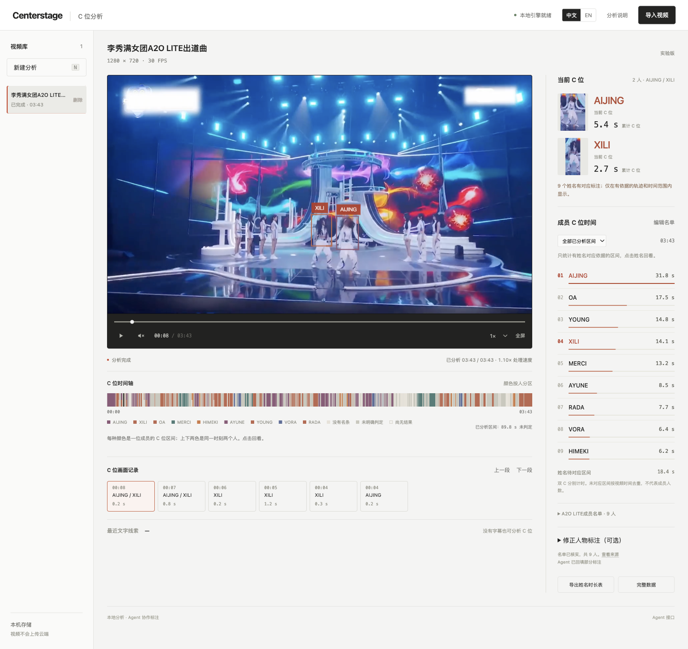

# CenterStage

本地舞台 C 位分析。导入演出视频后，在本机浏览器查看 C 位框、按成员分色的时间轴，以及累计 C 位时间。

Local stage-center analysis. Import a performance video and review center boxes, a member-colored timeline, and cumulative center time in a browser on this computer.



截图来自本地任务「李秀满女团 A2O LITE 出道曲」在 **0:08** 的画面。当时的双 C 是 **XILI** 和 **AIJING**。时间轴颜色对应这条任务里已有明确标注的成员，右侧是该任务的累计 C 位时间。原视频、模型权重和 `.centerstage` 任务数据不在仓库中。新导入的视频不会自动带上这些姓名。

This is the local job for A2O LITE’s debut stage, NEON, at **0:08**. The two centers are **XILI** and **AIJING**. Timeline colors follow members who already have an explicit annotation on this job, and the ranking is that job’s cumulative center time. The source video, model weights, and `.centerstage` job data are not in the repository. A newly imported video does not receive these names.

## 中文

把仓库交给已有的 Agent 使用。安装、启动、来源检索和有依据的标注流程见 [AGENTS.md](AGENTS.md) 与 [AGENT_GUIDE.md](AGENT_GUIDE.md)。

```sh
uv sync --frozen
uv run centerstage serve --port 8640
```

打开 <http://127.0.0.1:8640>。需要 Python 3.12 或 3.13，以及 uv。依赖版本锁在 `uv.lock`。首次启动会准备本地模型，这段时间不算进视频首段等待。同一数据目录只运行一个服务进程。

也可以由 Agent 导入：

```sh
uv run centerstage analyze /absolute/path/performance.mp4 --wait
uv run centerstage requests
uv run centerstage agent-context JOB_ID
```

分析在本机完成，不依赖外部大模型接口。来源检索由接收仓库的现有 Agent 完成。当前没有“上传后自动唤醒任意 Agent”的实现。

### 当前功能

- 导入 MP4、MOV、M4V、MKV、WebM，最大 2 GB、30 分钟、4K。
- 本机 RTMO-s 检测，OC-SORT / ByteTrack / CBIoU 追踪，切镜检测，以及实验性的视觉 C 位评分。
- 边分析边播放。人物框、时间轴和累计时长使用视频时间。
- 界面可切换中文或英文。播放、暂停和声音是图标。视频库可以删除一条任务。
- 带明确来源和时间范围的姓名标注会进入当前 C 位、分色时间轴和成员榜。
- CSV 导出姓名时长表。JSON 保留完整分析和诊断数据。
- 浅色工作台：左侧视频库，中间播放器和时间轴，右侧当前 C 位和时长排名。

轨迹条数不是成员人数。切镜或遮挡会产生新轨迹，界面不会把它们显示成“人物 001”。名单、演唱字幕和相似服装不能单独证明画面中的人是谁。服装关联只合并匿名时长，不传播姓名。

已标注的姓名按视频时间累计。暂停、回退和重播不重复累加。双 C 分别计入各自有依据的姓名。尚未对应的区间按时间并集计算，不把两个匿名框加成两倍时长。

### 尚未完成

- 任意新视频的全自动认名。
- 跨镜头记住同一个人。
- 每个 C 位框都有姓名。上面这条案例里，群舞、两人署名和难以分辨的画面仍有未命名时间。
- 独立的 C 位准确率验收。

C 位判断看几何中心和可见人脸数量。它是实验性视觉规则，不是官方固定站位，也不是演唱者识别。处理速度取决于机器、分辨率、采样率和场景。落后时会缓冲等待，也可以等整段分析完再看。

姓名状态见 [docs/NAME_STATUS.md](docs/NAME_STATUS.md)。验证记录见 [docs/VALIDATION.md](docs/VALIDATION.md)。

### Agent 接口

| 接口 | 用途 |
| --- | --- |
| `GET /api/health` | 本地引擎与可选 OCR 状态 |
| `POST /api/jobs` | 上传视频，multipart 字段为 `file` |
| `GET /api/jobs` | 视频库 |
| `DELETE /api/jobs/{id}` | 删除一条视频及其本地分析结果 |
| `GET /api/jobs/{id}` | 进度、来源名单、`name_status` |
| `GET /api/jobs/{id}/frames?after=N` | 增量结果，用返回的 `next` 继续 |
| `GET /api/agent/requests` | 待查来源和待审阅标注 |
| `GET /api/jobs/{id}/agent-context` | 轨迹、文字线索和实际审阅快照 |
| `PUT /api/jobs/{id}/roster` | 有来源的出演候选名单 |
| `PUT /api/jobs/{id}/annotations` | 有明确人物依据、带时间范围的姓名标注 |
| `GET /api/jobs/{id}/statistics?view=members` | 按姓名统计，与网页一致 |
| `GET /api/jobs/{id}/export?format=csv&view=members` | 姓名时长 CSV |
| `POST /api/jobs/{id}/cancel` | 停止分析，保留已有结果 |

统计和导出可以加 `until=SECONDS`，对齐播放进度。默认 `view=tracks` 是轨迹诊断，不是成员榜。`track_count` 不是人数。

出演名单、演唱者字幕、服装相似或轨迹排序不能证明画面人物身份。旧的 `/auto-identify` 猜名入口已停用。协议见 [docs/AGENT_PROTOCOL.md](docs/AGENT_PROTOCOL.md)。

### 检查

```sh
uv run pytest -q
node --check centerstage/static/app.js
node --test tests/*.test.mjs
```

## English

Give this repository to an existing agent. Setup, startup, source research, and evidence-backed annotation are documented in [AGENTS.md](AGENTS.md) and [AGENT_GUIDE.md](AGENT_GUIDE.md).

```sh
uv sync --frozen
uv run centerstage serve --port 8640
```

Open <http://127.0.0.1:8640>. Requires Python 3.12 or 3.13 and uv. Dependency versions are locked in `uv.lock`. The first launch prepares the local model; that time is separate from the first playable segment. Run one server process per data directory.

An agent can also import from the command line:

```sh
uv run centerstage analyze /absolute/path/performance.mp4 --wait
uv run centerstage requests
uv run centerstage agent-context JOB_ID
```

Analysis runs locally after the model is prepared. Source lookup is done by the agent that receives the repository. Uploading a video does not by itself wake an arbitrary agent.

### What works now

- Import MP4, MOV, M4V, MKV, and WebM, up to 2 GB, 30 minutes, and 4K.
- Local RTMO-s detection, OC-SORT / ByteTrack / CBIoU tracking, shot changes, and an experimental visual center score.
- Playback can start while analysis continues. Boxes, the timeline, and totals use media time.
- The interface switches between Chinese and English. Play, pause, and sound are icons. A library row can be deleted.
- A name with an explicit source and a time range appears on the current center, the colored timeline, and the member ranking.
- CSV exports named durations. JSON keeps the full analysis and diagnostic data.
- Light workbench: library on the left, player and timeline in the center, current center and ranking on the right.

A track count is not a member count. A roster, a sung-credit caption, or similar clothing does not by itself identify the person in frame. Garment links may combine anonymous time. They do not copy names.

Named totals follow video time. Pause, rewind, and replay do not add the same moment twice. Two centers at one moment are counted separately when each has a supported name. Unnamed center intervals are unioned, so two anonymous boxes do not become twice the duration.

### Not finished

- Automatic names for an arbitrary new video.
- Remembering the same person across shots.
- A name on every center box. This case still has unnamed time in group formations, two-name credits, and frames that cannot be told apart.
- An independent accuracy check of the center decision.

The center rule uses geometric position and the count of visible faces. It is an experimental visual baseline, not an official formation chart and not a singer identifier. Speed depends on the machine, resolution, sample rate, and scene. Playback waits when analysis falls behind, or the whole video can be analyzed before watching.

See [docs/NAME_STATUS.md](docs/NAME_STATUS.md) and [docs/VALIDATION.md](docs/VALIDATION.md).

### Agent API

| Endpoint | Purpose |
| --- | --- |
| `GET /api/health` | Local engine and optional OCR status |
| `POST /api/jobs` | Upload; multipart field `file` |
| `GET /api/jobs` | Video library |
| `DELETE /api/jobs/{id}` | Delete one video and its local analysis |
| `GET /api/jobs/{id}` | Progress, source roster, `name_status` |
| `GET /api/jobs/{id}/frames?after=N` | Incremental results; continue from `next` |
| `GET /api/agent/requests` | Pending source lookups and annotation reviews |
| `GET /api/jobs/{id}/agent-context` | Tracks, text clues, and the reviewed snapshot |
| `PUT /api/jobs/{id}/roster` | Candidate roster with a source |
| `PUT /api/jobs/{id}/annotations` | Time-bounded names with explicit person evidence |
| `GET /api/jobs/{id}/statistics?view=members` | Named totals, matching the page |
| `GET /api/jobs/{id}/export?format=csv&view=members` | Named-duration CSV |
| `POST /api/jobs/{id}/cancel` | Stop analysis and keep finished frames |

Statistics and export accept `until=SECONDS` for the playhead. The default `view=tracks` is a fragment diagnostic, not the member ranking. `track_count` is not a person count.

A roster, singer caption, garment similarity, or track order does not prove who is visible. The old `/auto-identify` guess path is disabled. See [docs/AGENT_PROTOCOL.md](docs/AGENT_PROTOCOL.md).

### Checks

```sh
uv run pytest -q
node --check centerstage/static/app.js
node --test tests/*.test.mjs
```

## 本地数据与许可 / Data and license

`.centerstage/` 保存视频、模型和任务，不进入 Git。`evidence/` 是本地验证材料。不要把用户视频或模型权重提交到仓库。

`.centerstage/` holds videos, models, and jobs and is not committed. `evidence/` is local validation material. Do not commit user videos or model weights.

原创代码使用 [Apache-2.0](LICENSE)。依赖、模型和论文的条款见 [THIRD_PARTY.md](THIRD_PARTY.md)。

Original code is [Apache-2.0](LICENSE). Dependencies, models, and papers are credited in [THIRD_PARTY.md](THIRD_PARTY.md).
